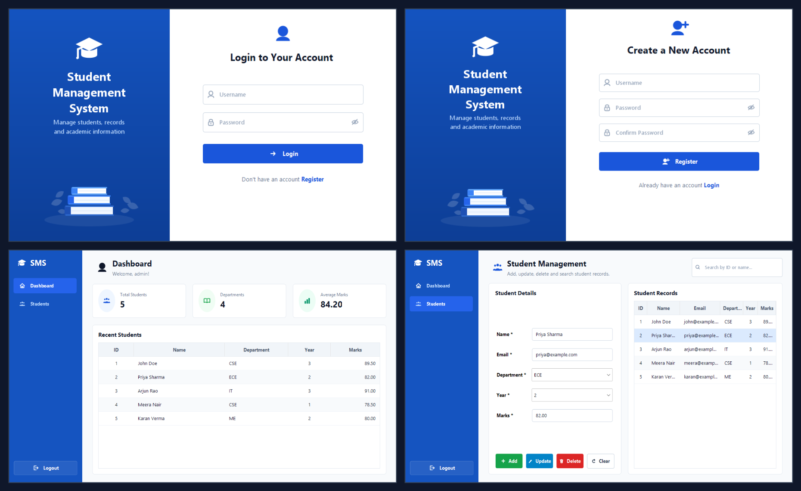

# 🎓 Student Management System (SMS) with Authentication

A modern, production-ready Java desktop application featuring secure user authentication (BCrypt hashing) and comprehensive student record management (CRUD operations, real-time search, dynamic metrics dashboard). Built with **Java 21**, **Java Swing**, **JDBC**, and **MySQL**, adhering to clean layered architecture principles.

---

## 📸 Application Showcase



| Screen | Description |
|---|---|
| **Login Screen** | Secure login with leading icons, password reveal toggle, and registration navigation |
| **Registration Screen** | New account creation with field validation, password confirmation, and BCrypt hashing |
| **Dashboard** | Overview with live stat cards (Total Students, Departments, Average Marks) and Recent Students |
| **Student Management** | Two-column workspace for adding, editing, deleting (with confirmation), and searching student records |

---

## 🛠️ Technology Stack

| Layer / Component | Technology | Description |
|---|---|---|
| **Language** | Java 21 (LTS) | Modern Java features (Records, Pattern Matching, Text Blocks) |
| **GUI Framework** | Java Swing & AWT | Modern UI with custom Java2D vector graphics and anti-aliased rendering |
| **Look & Feel** | FlatLaf 3.5.1 | Clean, contemporary typography and native desktop polish |
| **Database** | MySQL 8.0+ | Relational schema with primary keys, auto-increment, and unique constraints |
| **Connectivity** | JDBC (MySQL Connector/J 8.3.0) | Safe database communication via `PreparedStatement` & try-with-resources |
| **Security** | jBCrypt 0.4 | Industry-standard salted password hashing (12 rounds) |
| **Build Tool** | Apache Maven | Modular dependency management and lifecycle automation |

---

## 🚀 Key Features

### 1. 🔐 Authentication & Session Module
- **User Registration**:
  - Validates non-empty fields, minimum length (username ≥ 3, password ≥ 4).
  - Enforces password confirmation matching.
  - Verifies unique usernames against MySQL before creation.
  - Hashes passwords using **BCrypt** with high-entropy salt before persisting.
- **Secure Login**:
  - Authenticates users via BCrypt verification (`BCrypt.checkpw`).
  - Protects against credential probing with unified invalid credentials messaging.
  - Enter-key support for seamless keyboard workflow.
- **Session Tracking & Logout**:
  - Keeps active session state in `AuthService`.
  - Confirmation dialog on logout that safely clears user session and returns to login.

### 2. 📊 Real-Time Analytics Dashboard
- **Metric Cards**:
  - **Total Students**: Live count of all active records.
  - **Departments**: Dynamic count of distinct academic departments.
  - **Average Marks**: Computed GPA/average marks across all student records.
- **Recent Students Table**:
  - Displays latest registered student records in a clean tabular view.

### 3. 📝 Student Management (Complete CRUD)
- **Add Student**: Full form validation (Name ≥ 2 chars, valid email syntax, department selection, academic year 1–4, marks 0–100).
- **View Records**: Formatted `JTable` with alternating row colors, centered IDs/Years, and right-aligned decimal marks (`%.2f`).
- **Interactive Selection**: Selecting a row instantly populates the edit form on the left.
- **Update Student**: Modifies student details with email duplicate prevention against other records.
- **Delete Student**: Deletes records with a warning confirmation dialog.
- **Live Search**: Instant real-time filtering by **Student ID**, **Student Name**, **Email**, or **Department** as you type.
- **Form Reset**: One-click clear button to reset input fields and selections.

---

## 🗄️ Database Design

**Database Name:** `student_management`

### 1. `users` Table
```sql
CREATE TABLE IF NOT EXISTS users (
    id INT PRIMARY KEY AUTO_INCREMENT,
    username VARCHAR(50) UNIQUE NOT NULL,
    password_hash VARCHAR(255) NOT NULL,
    created_at TIMESTAMP DEFAULT CURRENT_TIMESTAMP
);
```

### 2. `students` Table
```sql
CREATE TABLE IF NOT EXISTS students (
    student_id INT PRIMARY KEY AUTO_INCREMENT,
    name VARCHAR(100) NOT NULL,
    email VARCHAR(100) NOT NULL UNIQUE,
    department VARCHAR(50) NOT NULL,
    year INT NOT NULL,
    marks DOUBLE
);
```

---

## 📂 Project Architecture

The application strictly follows a layered architecture to ensure separation of concerns, testability, and code maintainability:

```
Student CRM/
├── pom.xml                                  # Maven project configuration
├── database.sql                             # Database schema & sample seed data
├── README.md                                # Comprehensive documentation
├── screenshots/                             # Application screenshots
│   ├── 0_sms_overview_grid.png
│   ├── 1_login_screen.png
│   ├── 2_register_screen.png
│   ├── 3_dashboard_screen.png
│   └── 4_student_management_screen.png
└── src/
    └── main/
        ├── resources/
        │   └── db.properties               # MySQL connection configuration
        └── java/
            └── com/sms/
                ├── Main.java                # Application bootstrap & entry point
                ├── model/
                │   ├── User.java            # User entity
                │   └── Student.java         # Student entity
                ├── database/
                │   └── DBConnection.java    # JDBC connection manager & schema init
                ├── dao/
                │   ├── UserDAO.java         # Data access for users
                │   └── StudentDAO.java      # Data access for students & metrics
                ├── service/
                │   ├── AuthService.java     # Authentication & BCrypt service
                │   └── StudentService.java  # Business logic, validations & DTOs
                ├── ui/
                │   ├── UITheme.java         # Color palette, fonts, spacing tokens
                │   ├── IconHelper.java      # High-res vector graphics painters
                │   ├── BrandingPanel.java   # Reusable royal-blue brand banner
                │   ├── ModernButton.java    # Custom rounded button with states
                │   ├── ModernTextField.java # Rounded input with leading icons
                │   ├── ModernPasswordField.java # Password input with eye toggle
                │   ├── CardPanel.java       # Clean bordered rounded card
                │   ├── ModernTableHelper.java# Table header, padding & cell renderers
                │   ├── LoginFrame.java      # Login interface
                │   ├── RegisterFrame.java   # Registration interface
                │   └── DashboardFrame.java  # Main dashboard & CRUD workspace
                └── util/
                    ├── SystemVerifier.java  # Automated E2E test verification suite
                    └── ScreenshotGenerator.java # High-res screenshot generator
```

---

## ⚙️ Installation and Setup Guide

### 1. Prerequisites
- **JDK 21 or higher** (`java -version`)
- **Apache Maven 3.8+** (`mvn -version`)
- **MySQL Server 8.0+** running locally

### 2. Configure Database
1. Open MySQL CLI or MySQL Workbench:
   ```bash
   mysql -u root -p
   ```
2. Run the `database.sql` script to create the database, tables, and initial schema:
   ```bash
   mysql -u root -p < database.sql
   ```
3. Update connection credentials in `src/main/resources/db.properties` with your database username and password:
   ```properties
   db.url=jdbc:mysql://localhost/student_management?useSSL=false&allowPublicKeyRetrieval=true&serverTimezone=UTC
   db.user=your_username
   db.password=your_password
   ```
   *(Alternatively, you can set environment variables `SMS_DB_URL`, `SMS_DB_USER`, and `SMS_DB_PASSWORD` without modifying the file).*

### 3. Build & Compile
In the project root directory, run:
```bash
mvn clean compile
```

### 4. Run the Application
Execute directly via Maven:
```bash
mvn exec:java
```
Or launch the main class directly using Java:
```bash
java -cp "target/classes;target/dependency/*" com.sms.Main
```

### 5. Default Login Credentials
- **Username:** `admin`
- **Password:** `password123`
*(Or click "Register" on the login screen to create a new user account)*

### 6. Run Automated Verification Tests
To run the automated integration test suite that verifies DB connectivity, authentication, BCrypt hashing, and all CRUD operations:
```bash
java -cp "target/classes;target/dependency/*" com.sms.util.SystemVerifier
```

---

## 🛡️ Best Practices & Quality Standards Implemented

- **SQL Injection Prevention:** Every query utilizes `PreparedStatement` with parameterized placeholders.
- **Resource Management:** Automatic resource closing using `try-with-resources` on all `Connection`, `PreparedStatement`, and `ResultSet` instances.
- **Password Security:** Salted BCrypt hashing with 12 computational rounds. Plain-text passwords are never stored in memory or in the database.
- **Architectural Decoupling:** Separation of concerns ensures Swing UI classes never make direct database calls; all interactions route through DAO and Service layers.
- **Input Validation:** Rigorous checks on strings, email regex patterns, integer bounds, and floating-point ranges.
- **Modern UI/UX:** Consistent color tokens, typography scales, vector-drawn icons, and responsive layout management.

---

## 📄 License
This project is open-source and free to use for educational, personal, and professional portfolio purposes.

